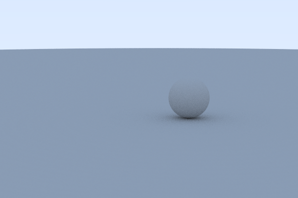

# Ray tracing: CPU / GPU

Measured locally on Apple M4 Pro, 2026-11-22. Apple Clang 17, Homebrew libomp; `-O3 -march=native -ffp-contract=off`.

Samples/pixel: 100. OpenMP threads (maximum): 14. One warm-up and 3 measured runs per size; median wall time.

OpenCL includes kernel submission, all ray tracing, synchronization and RGB download. Context/program/buffer setup and PPM/video encoding are excluded from both timings.

| Image | OpenMP time, ms | OpenCL time, ms | CPU/GPU | RMSE |
|---|---:|---:|---:|---:|
| 150x100 | 7.94854 | 4.63079 | 1.71645 | 0 |
| 300x200 | 34.1193 | 4.75658 | 7.17307 | 0 |
| 600x400 | 143.923 | 10.1549 | 14.1728 | 0 |
| 900x600 | 293.419 | 17.8225 | 16.4634 | 0 |

Verification: PASS. OpenCL faster at every measured size: YES.

