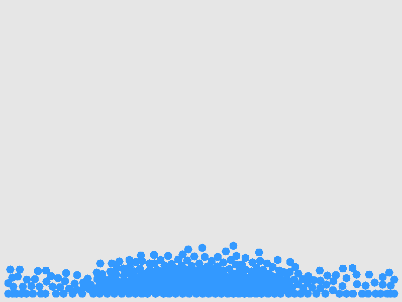

# SPH benchmark

Apple M4 Pro, macOS; Apple Clang 17 + Homebrew libomp. Measured 2026-11-22. Flags: `-O3 -march=native -ffp-contract=off`.

OpenMP max threads: 14. Three warm-up frames, then 120 frames; median wall-clock duration. GPU includes all three kernels and blocking particle download. Initial upload, allocation, compilation and rendering excluded.

| Particles | OpenMP Frame duration, ms | OpenCL Frame duration, ms | CPU/GPU | Max position error |
|---:|---:|---:|---:|---:|
| 340 | 0.148125 | 0.250083 | 0.592303 | 0 |
| 1024 | 0.319459 | 0.321333 | 0.994168 | 0 |
| 2048 | 0.693875 | 0.507875 | 1.36623 | 0 |
| 4096 | 2.09104 | 0.868291 | 2.40823 | 0 |
| 8192 | 8.40467 | 1.69587 | 4.95595 | 0 |

Verification: PASS. All compared particle states matched exactly on this device.

GPU faster for 2048, 4096 and 8192 particles. For the original 340-particle scene GPU is slower; 1024 particles are approximately tied. The speed condition is not satisfied at every size.

Images after 120 simulation steps, 340 particles (PPM files matched byte-for-byte):

